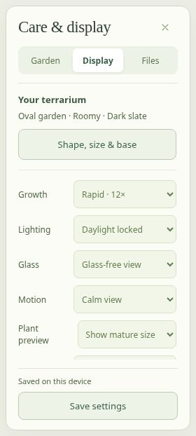

# Desktop workspace and settings verification

Reviewed October 29, 2026. The production app remains at https://ilevytate.github.io/Verdant/.

The desktop layout has a collapsible building panel, a centered editing dock, and a bounded right rail. Settings and inspection share the right rail rather than covering each other. Desktop settings are grouped into Garden, Display, and Files, with a fixed save-status/footer and a separately scrolling content area. The header exposes Settings and Terrarium directly. Compact desktop widths reduce secondary labels while preserving accessible names. Mobile retains its existing tray and Care layout.

Phones and desktops begin in Observe. Clicking an existing plant in Observe opens inspection. Number keys 1–9 choose every plant; size/rotation shortcuts also work after clicking a tool button. The editing dock, category tabs, and settings-section controls support arrow/Home/End navigation; unavailable Undo/Redo controls are skipped, and browser modifier shortcuts are preserved. The building panel can be collapsed without covering the editing dock. Camera framing measures the new dock, hint, right rail, and inspector.

## Saving corrections

- Periodic UI refresh previously reassigned focused dropdown values. A choice being edited is now left alone until it is committed or focus leaves the control.
- Display, care-mode, and weather preferences write immediately. High-frequency garden edits retain the existing autosave debounce.
- The terrarium editor prepares a candidate world, creates a restore point, and confirms the candidate save before applying its geometry or closing the form. A failed save retains both the form and the current garden. Session Undo is recorded only after the save succeeds.
- Primary, backup, checkpoint, recovery, and restore-point writes are read back. A silently discarded write does not report success. Save failures remain visible and retain export/retry controls.
- Saved status appears in the desktop footer and Settings. Desktop settings stay open while focus moves to the garden; explicit Close/Escape and inspection still dismiss them.

Existing world keys, schemas, terrain, plant identities/progress, and archived animal records are retained. These changes do not add cloud synchronization; saves remain associated with the current browser and origin.

## Evidence

All twenty existing logic, storage, production DOM, update, and scene suites pass. Expanded tests load a second app instance from the first instance's stored data and check graphics, glass, motion, growth, lighting, vessel shape/size, and base finish. They also exercise a focused dropdown across UI refreshes, ignored writes, failed terrarium saves/retry, keyboard shortcuts, desktop panel collapse, and Observe inspection.

Browser UI checks use the production HTML/CSS/core/save/game code with Babylon NullEngine and a readiness shim in a separate, unpublished fixture. Actual WebGL remains unavailable in the cloud browser. This verifies DOM layout and real browser-local save/reload behavior, not GPU visuals or frame rates.

- Measured 901×600, 1024×768, 1280×800, and 1600×900 desktop viewports: header controls fit, there is no page-width overflow, and the checked panel/dock/footer pairs do not overlap.
- Confirmed the settings content and save controls occupy separate rectangles, including the compact 901×600 viewport and wide settings view.
- Saved Performance graphics, Glass-free view, and Calm view through the actual browser controls, then reloaded and verified all three selections.
- Saved an Oval / Roomy / Dark slate terrarium, reloaded, and verified its summary and selections remained present with a saved confirmation.

The screenshot below is the actual desktop settings DOM after that reload. The 3D renderer is substituted in the UI fixture; no game-scene or GPU-performance claim is implied.

## Remaining device acceptance

Check a real WebGL desktop browser at normal and increased browser zoom, including keyboard-only use, wheel scrolling inside the building/settings panels, inspector and bonsai actions, photo mode, and graphics switching. Verify the rendered garden remains framed between panels. Physical GPU appearance, FPS, heat, and native installation/update dialogs remain separate acceptance work in `MOBILE_QA.md`.
