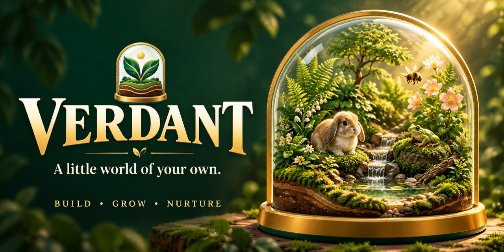

# Verdant

<p align="center"></p>

[Play Verdant](https://ilevytate.github.io/Verdant/) · [Download game ZIP](https://github.com/iLevyTate/Verdant/archive/refs/heads/main.zip) · [Social preview image](assets/verdant-social.jpg)



A mobile-first, procedural 3D terrarium game. Build a little world, nurture plants, welcome tiny wildlife, and follow the Garden Journey.

**Plain HTML, CSS, and JavaScript. No Jekyll, Ruby, framework, compilation, or backend is required to host the game.** The Babylon.js engine and environment lighting are bundled locally, and the interface uses device fonts with no external font requests.

## New in this version

- **Install as a PWA** from Care & display or Field Guide → Your world. Supported browsers offer native installation; iPhone/iPad users get Add to Home Screen instructions. PNG launcher icons, a maskable icon, and an Apple touch icon are included.
- **Offline play** after the first complete online visit. The service worker caches the complete game, engine, and lighting locally, with scope-relative paths for GitHub Pages project URLs. Waiting updates have an explicit Update app button and save before reloading.
- **Self-sustaining** is the default care mode: plants and wildlife are protected from neglect. Build, experiment, and leave whenever you like.
- **Pet Care** tracks food, water, cleanliness, vitality, and time together. Feed, water, and tidy about twice a day. Needs use real time, including while closed or the ecosystem is paused; growth and 20× simulation speed do not accelerate them. Extended neglect can end the world's life. Revive keeps the landscape and journey.
- Choose care mode during world creation or change it in Care & display / Field Guide → Your world. Care mode is independent of Garden Journey / Free build, so both care choices work with either building mode. Switching preserves the layout and progression and starts with fresh needs.

- Bumblebees visit flowers and help pollination.
- Little tree frogs hop through moss and perch on low branches.
- Micro Holland Lop bunnies have soft bodies, floppy ears, grazing motions, and small hops.
- Plant growth starts at **Rapid 12×**, independently of simulation speed. Natural 1×, Quick 6×, and Burst 24× are available.
- **Daylight locked** is the default. Switch between locked daylight, the natural cycle, and locked moonlight while the clock, weather, and ecosystem keep progressing.
- A phone-sized tool tray, larger touch controls, collapsible care settings, and close-up camera views keep the living world visible.
- Physically based creature and glass materials, bundled studio illumination, smoother plant models, reflective animated water, antialiasing, and subtle bloom. Cinematic adds stronger antialiasing and ambient occlusion where supported; Auto is the default for phones.

## Host on GitHub Pages, without Jekyll

The standalone repository has `index.html` and `.nojekyll` at its root. Assets use relative paths, so both a domain root and a Pages project URL work.

### GitHub Pages from main

This repository is prepared for **Deploy from a branch → main → / (root)**. The root .nojekyll marker bypasses Jekyll, and the game files are served directly without a build. The included Game checks workflow tests changes and does not run a second deployment.

### Repository logo and social preview

- The transparent logo is at [assets/verdant-logo.png](assets/verdant-logo.png).
- The upload-ready GitHub social preview is [assets/verdant-social.jpg](assets/verdant-social.jpg), exactly **1280 × 640**, under 1 MB.
- To set the repository card, open **Settings → General → Social preview → Edit → Upload an image**, choose that JPG, and save. Website Open Graph and Twitter metadata already use this card for shared game links.
- Launcher icons and the game header use the new emblem. See [BRANDING.md](BRANDING.md) for source artwork and generation notes.

### Other static hosts

Publish the folder containing `index.html`. There is no build command. Keep `assets/`, `vendor/`, all JavaScript and CSS files, `sw.js`, and `manifest.webmanifest` beside it. Serve over HTTPS for PWA installation and offline support. The bundled server on localhost also supports PWA development. No account service or API credentials are needed for gameplay.

## Play locally

With Node 22 or newer:

```
npm start
```

Open `http://localhost:8080`. Installing npm dependencies is not required simply to serve and play the bundled game. An HTTP server is needed because browsers restrict loading environment textures through `file://` URLs.

## Install and play offline

The primary website is **https://ilevytate.github.io/Verdant/** and opens directly into the app. Choose **Get app** in the top bar for installation instructions or **Download game files (.zip)**. The ZIP always comes from the current `main` branch and contains the complete app and its assets. Installation is also available in **Care & display**. Chrome and Edge can show their native prompt; the fallback panel explains iPhone/iPad, Android, and Mac installation. Wait for **Ready to play offline** before disconnecting. The first complete cache is roughly 9 MB. Installed and browser play use local device storage; use world export/import to transfer saves between hosts or devices.

The service worker intercepts only the game's own static shell, not API routes, account data, downloads, or other projects on the same origin. Updates keep one complete release together until you choose **Update app**. When releasing future changes, bump the cache version in `sw.js`.

## Mobile controls

- Choose Plants, Terrain, or Life, then tap the soil to place an element. Swipe the tray horizontally to see more choices.
- Drag to orbit and pinch to zoom. Observe collapses the tray. The handle reopens it.
- Use the sliders icon for **Care & display**: mist, vent, sunlight, weather, growth speed, lighting lock, and graphics quality.
- Inspect an element to harvest, move, remove, or open its **Close-up** view. Reset the camera to return to the complete terrarium.
- Gold rings mark seeds ready to collect. The tray's harvest button collects every ready plant.
- The sun/moon button cycles Daylight locked → Natural cycle → Moonlight locked. This changes the view rather than skipping time.
- Pause freezes the procedural simulation. Pet Care needs still follow real time. Growth speed and lighting remain independent of the 1×, 5×, and 20× simulation clock.

Desktop shortcuts: Space pauses, M mists, I inspects, R rotates, −/+ changes element size, H hides the UI, Escape selects Observe, and Ctrl/Command Z or Ctrl/Command Shift Z undo and redo.

## The living landscape

Seeded woodland, rainforest, and desert terrain includes hills, valleys, creeks, islands, dunes, and oases. Weather follows the seed, time, and biome-specific seasons. A saved soil-moisture grid responds to rain, evaporation, slopes, shorelines, moss, and canopy shelter. Wet slopes gradually transport soil downhill. Healthy plants can self-seed in suitable, uncrowded soil.

Trees soften local light, organic matter feeds nearby growth, and bees and butterflies help flowers make seeds. The **Living landscape** setting controls self-seeding and erosion. There are nine plant species and seven creature species, eight journey chapters, five habitat discoveries, and seven ranks. Free build removes planting costs while keeping the simulation and progression.

This is an illustrative game, not a biological or fluid-dynamics model. The tiny animals are imaginative terrarium inhabitants, not real-world husbandry guidance.

## Saves and settings

Worlds save automatically in the current browser. New world offers JSON export and validated import for moving between devices or hosting domains. Earlier saved layouts are preserved and gain the rapid-growth and daylight-lock defaults if those settings are missing.

The procedural terrain and growth simulation runs while the page is visible. Pet Care needs catch up from the last saved timestamp when you return, including offline. Self-sustaining worlds remain safe while away. Earlier saves default to Self-sustaining to avoid retroactive neglect. The scene limit is 220 elements, and natural spreading is capped at thirty offspring.

## Development and checks

```
npm ci
npm run check
npm test
npm run test:scene
```

The scene test uses Babylon's official NullEngine and `@napi-rs/canvas` to validate all biome scenes, model geometry, placement previews, harvest markers, selections, and fitted cameras on four phone layouts without a GPU. Additional tests cover care catch-up, neglect/revival, save migration, manifest icons, complete offline assets, subfolder URLs, and cache isolation. Live WebGL appearance must still be checked on a device with WebGL support.

`node scripts/prepare-pages.mjs` prepares the static `_site/` directory. In an editing checkout that has `dist/`, the server and packaging helpers use that folder. In the standalone repository, they use the root game files.

## Credits

- Rendering engine: Babylon.js 8.32.0, Apache License 2.0. See `vendor/BABYLON-LICENSE.md`.
- Studio environment: Babylon.js Assets contributors, Creative Commons Attribution 4.0. The environment is unchanged apart from its filename. See `assets/ATTRIBUTION.md` and `assets/BABYLON-ASSETS-LICENSE.txt`.
- Scene, plants, animals, terrain, and audio are generated from this project's source code. Brand artwork was generated with OpenAI image generation. No external model downloads are needed to play.
