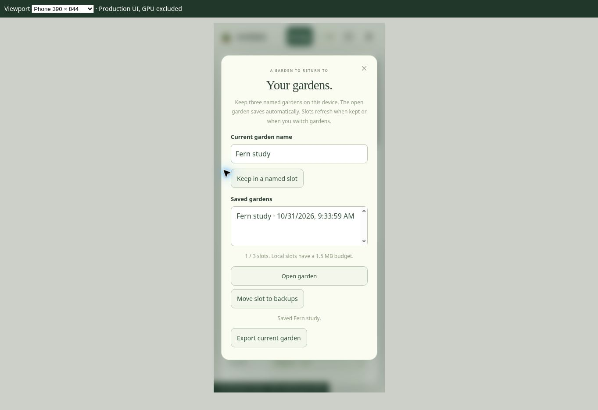

# Version 4 implementation record

Implemented October 31, 2026 from the fourteen recommendations in `IMPROVEMENT_RESEARCH.md`. Babylon.js 8.32.0 remains the engine. The table distinguishes shipped software from physical-device acceptance.

| Plan | Implemented | Verification and limits |
| --- | --- | --- |
| R1 | Device graphics, motion, lighting, glass, mature preview, battery and desktop panel choices follow garden creation/import/restore/switching. Missing preferences inherit the existing saved choices. Audio preference is remembered, with a gesture still required to start playback. | Preference and production DOM reload/switch tests; garden-specific growth/care remain separate. |
| R2 | One participating editing tab holds an exclusive Web Lock for the session. Primary, recovery, checkpoints and slots obey ownership. A persistent viewing banner offers export and reclaim. BFcache return reloads the current revision. Verified writes, storage health, persistence requests and history-only quota pruning preserve the authoritative garden and recovery copies. | Ownership and stale-write tests. Unsupported Web Locks are explicitly labelled single-tab saving, without claiming equivalent atomic protection. Native HTTPS cross-browser contention remains manual acceptance. |
| R3 | SHA-256 hashes verify every offline file before installation. Live documents retain their release assets, with mappings persisted across worker restarts. Unknown legacy tabs block new editing until closed/updated. Activation still needs consent and a confirmed world checkpoint. Build/check status and failure/retry are exposed. | Two-client/restart/legacy/missing-asset/hash-drift/offline-install/completeness/collection harness. Native installed-browser lifecycle remains device acceptance. |
| R4 | Downloadable frame percentiles, CPU animation/submission, simulation percentiles, draw calls, shader compilation and GPU timing when available. Context loss blocks edits, exposes export/retry and keeps the world. The CPU benchmark now measures 780 frames and 130 simulation ticks after warm-up. | Twenty-seven generated production WebGL2 shader pairs compile/link in Mesa GLES 3.2 software rendering. GPU appearance, color, hardware performance, heat and actual context restoration remain unverified. |
| R5 | Species root zones, stones/crystals and rotated log capsules prevent solid overlaps in placement/relocation/transforms/spreading. Foliage may overlap with a desktop crowding hint. Shade/retention scale with canopy size. Vessel changes preview the constrained-specimen count; old layouts retain saved coordinates with render-only glass fitting. | Core clearance and actual-vertex mature-placement/vessel tests. No automatic deletion or relocation of old specimens. |
| R6 | View lighting changes no ecological time, growth or harvest outcome. Dusk discovery uses the simulation clock. | Identical worlds advanced with Daylight and Moonlight view choices produce identical ecology/economy state. Earned discoveries/rewards persist. |
| R7 | Auto detail follows projected specimen size with hysteresis and close-up promotion; manual quality remains explicit. Unchanged structures share geometry; pruning creates an isolated mesh. Local climate uses a per-tick spatial index. CPU animation pressure can reduce the automatic detail budget as well as resolution. | Dense phone geometry and source-sharing checks, exact preview and glass bounds. The 220-plant fixture references 1,131,924 plant triangles versus the audit's 2,889,300. Geometry reduction is not an FPS claim. |
| R8 | Four 1K diffuse maps use KTX2/ETC1S with bundled offline decoders and JPEG fallback. Normal and ARM maps retain their existing JPEGs. Battery mode caps drawing at 30 fps; paused Calm view redraws on camera/scene changes. | All four compressed maps decode locally to mobile ETC2 and desktop BC7, with eleven mip levels and correct color space. Final texture appearance and native fallback require hardware acceptance. Keeping both formats increases download size. |
| R9 | Per-organ leaf expansion/curl and small anchored motion replace whole-clump rocking. Stable specimen variation preserves saved variants. Eleven juniper branches have independent trim/regrow controls, with additive validated save metadata and isolated geometry. | Branch persistence, shared-source protection, bounds and shader compilation. This is a bounded visual approximation, not a physiological tree model or complete paper implementation. |
| R10 | Soil blends mineral color by slope, limits triplanar samples to steep surfaces outside Performance, changes roughness with wetness, and darkens a narrow shore band. Brushes use elapsed-time strength, path interpolation, strength/falloff controls and coordinate stamps. Sculpting updates nearby root/litter anchors and water-bed samples. | Exact terrain/ray/root/normal tests; the saved 3,073-point field stays intact. Final material appearance remains GPU acceptance. |
| R11 | Glass gains an opening-thickness cue. Cinematic uses an optional 512 px scene-dependent pond mirror refreshed every fourth render. Lower tiers retain the analytic water path. Natural-cycle sun direction and night environment intensity vary with rendered time. | Shader, geometry, resource and glass-free tests. Mirror projection, transparency and photographic color still need real-GPU before/after captures. |
| R12 | Searchable specimen selection, coordinate placement, numeric transforms, camera buttons and soil stamps provide keyboard/non-drag alternatives. Undo is labelled and applies edit fields/deltas while later growth, health, time and unrelated rewards continue. Last confirmed save time and persistent export/retry/backup-pressure feedback are visible. | Production DOM tests and desktop/phone browser fixture checks. Screen readers, true 200% browser zoom and full keyboard-only usability remain manual acceptance. |
| R13 | Biome-specific recipes and diversity targets preserve relaxed play and earned mission indices/discoveries/rewards. Field Guide lists the current recipe and labels ecology as illustrative. | Existing progression/compatibility suites and updated clock-based dusk fixture. |
| R14 | Three named garden slots with revision counts and a 1.5 MB UTF-16 budget, safe outgoing snapshots, explicit archive-to-backups, and active-slot reopening protection. Scene-only PNG export up to 1920 px, whole-garden/overhead presets and seed caption. Botanical social artwork replaces website social metadata. | Save/open/reload/failure/coordinate/transform tests and actual browser slot saving. PNG output/color needs a GPU. GitHub's repository Social preview upload remains a separate setting in BRANDING.md. |

## Save preservation and Undo

The primary remains `verdant-world-v1`, schema 2. Loading a valid world never generates a replacement. Terrain/soil, seed, entity identity/type/position/variant/size/growth/health, pruning, harvest, seeds, XP, missions/discoveries, care and archived wildlife are retained. Animals remain disabled and are not deleted. New preferences and slots use additional keys; no IndexedDB migration or independently authoritative second primary is introduced.

The open garden autosaves in the existing primary. Named slot rows refresh when explicitly kept or when leaving that named garden. Opening the active slot keeps its latest live progress. Slots have a defined budget and complement portable JSON exports and recovery points.

Ordinary Undo records edited fields, per-cell terrain/soil deltas and direct planting/removal/harvest transactions. Later growth/health, simulated clock, care age, mission rewards and unrelated preferences are kept. Redo of a removed planting uses its latest live record. Explicit world replacement/recovery has whole-world history; explicitly undoing a view setting restores that setting. Persistent storage is browser-controlled and does not prevent deliberate browser-data deletion. Export remains the portable backup.

## Controls

- Settings → Display: view/graphics/battery choices, camera buttons and diagnostics.
- Settings → Files: slots, storage, specimen list, coordinate placement/soil stamps, photos, exports and recovery.
- Inspect a juniper: whole-canopy and individual-branch controls, plus numeric transforms.
- Check for updates → Save & update now: consent plus a successful preservation checkpoint. Later keeps the update reachable.

## Verification

Run `npm ci`, `npm run check`, `npm test` and `npm run test:scene`. All twenty prior suites remain, with workspace, release, texture and detail/idle regressions added. CI uses Node 22.

`npm run bench:scene -- --fixtures test-artifacts` exports matching device fixtures and runs 900 frames with 120 warm-up frames. This measures NullEngine CPU components separately, not phone FPS or heat. Do not add component timings to infer frame rate. See BENCHMARK_BASELINE.md.

For optional Linux software shader compilation, choose an empty directory, run `node scripts/export-shaders.cjs /tmp/verdant-shaders`, then `python scripts/verify-shaders.py /tmp/verdant-shaders`. Mesa/EGL is required. The isolated fixture enables WebGL2 shader processing and texture readiness without changing production startup.

Cloud Chrome reports **WebGL not supported**. Browser UI checks therefore use production markup/CSS/core/storage/game with NullEngine and a readiness shim in an unpublished fixture. A named garden was saved through native controls at 1280 × 800 and inspected at 390 × 844. No substitute scene image is shipped. Physical GPU appearance, PNG color, compression fallback, offline installation, cross-tab rollout, context restoration, heat/touch behavior, true 200% zoom and assistive technology remain the manual tasks in MOBILE_QA.md and DESKTOP_QA.md.

